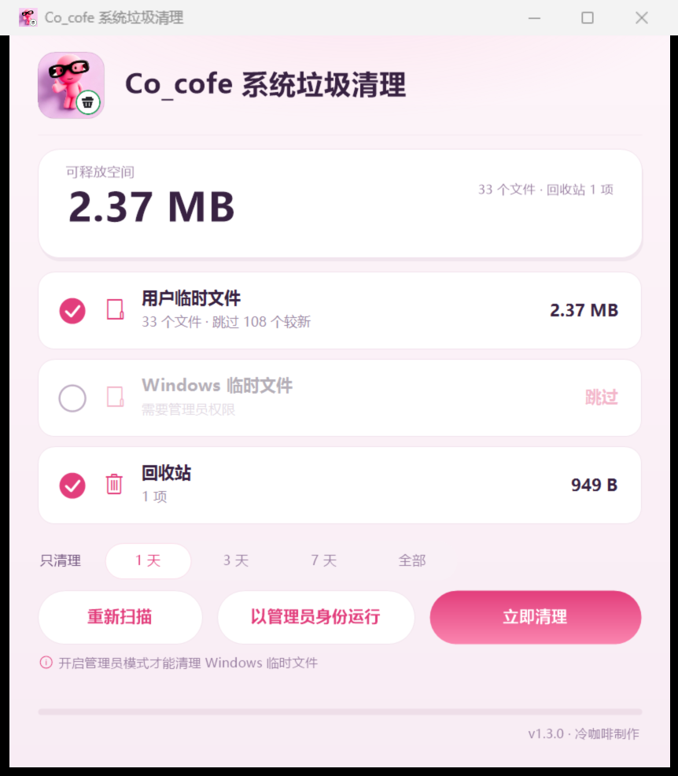

# Co_cofe 系统垃圾清理

> 只清临时文件和回收站的小工具 —— **不动你的文档、照片、程序和日志**。
>
> A tiny, safe Windows cleaner for temp files and the recycle bin. **No full-disk wildcard deletion.**



---

## 它解决的问题

网上流传的「一键清理系统垃圾.bat」喜欢 `del /f /s /q %systemdrive%\*.log`——
全盘删日志、删 `.old` 备份、清 prefetch，出问题时连排查线索都没了，
而且里面一半路径是 Windows XP 时代的老名字，在新系统上根本不存在。

这个工具只做三件事，其余一律不碰：

| 清理项 | 位置 | 说明 |
|---|---|---|
| 用户临时文件 | `%TEMP%` | 一般最占地方 |
| Windows 临时文件 | `%WINDIR%\Temp` | 需要管理员权限 |
| 回收站 | 所有驱动器 | 空的时候自动不勾选 |

## 安全规则

**不做的：**

- 不全盘扫描 C 盘，只进上面那三个位置
- 不删 `.log` 日志、`.old` 备份、`prefetch` 预读取
- 不碰文档、图片、视频、桌面、下载、程序目录
- 不跟随目录联接（ReparsePoint），不会"跑"到别的目录去删

**做的：**

- 只删 **N 天以前**的临时文件（默认 1 天，可选 3/7 天/全部），避免删掉正在安装用的临时文件
- 正在被占用的文件自动跳过，不报错、不强删
- 带「系统」属性的文件跳过
- 清完只回收已经变空的子目录，临时目录本身保留
- 每次清理逐条写日志

## 界面

- **提权独立按钮**：中间「以管理员身份运行」一点就 UAC 提权重启，Windows 临时文件那行自动解锁
- 三行分类点一下勾选/取消，实时显示可释放大小
- **窗口可调大小**，布局自适应；**记住上次的位置、尺寸和是否最大化**
- 非管理员时按钮下方有一行小提示，提权后自动消失
- 三行分类和三个按钮都有鼠标悬停说明

## 下载与安装

- 安装版：`安装包/Co_cofe系统垃圾清理_v1.3.1_安装版.exe`
  - 默认安装到 `C:\Program Files\Co_cofe系统垃圾清理`
  - 自动创建桌面和开始菜单快捷方式，写入「设置 → 应用」的卸载项
  - 命令行参数：`/SILENT` `/DIR="路径"` `/NODESKTOP` `/NOSTARTMENU`
- 绿色版：直接运行 `程序/Co_cofe系统垃圾清理.exe`（.NET Framework 4.x，Windows 自带，无需安装运行时）

## 命令行版

安装包里还附了一个无界面版本，适合挂计划任务：

```
Co_cofe系统垃圾清理-命令行.exe --dry-run     只预览
Co_cofe系统垃圾清理-命令行.exe --days 3      只清 3 天以前的
Co_cofe系统垃圾清理-命令行.exe --keep-recycle  不动回收站
Co_cofe系统垃圾清理-命令行.exe --yes         跳过确认
```

## 从源码构建

需要 Windows 自带的 `csc.exe`（`C:\Windows\Microsoft.NET\Framework64\v4.0.30319\csc.exe`），不需要 Visual Studio。

```powershell
# 主程序（图标取自 源码/图标/cleaner.ico）
powershell -NoProfile -ExecutionPolicy Bypass -File 源码\build.ps1

# 命令行版
powershell -NoProfile -ExecutionPolicy Bypass -File 源码\build.ps1 -Cli

# 安装包（先编卸载程序，再编安装程序）
powershell -NoProfile -ExecutionPolicy Bypass -File 源码\安装\build-installer.ps1
```

## 目录结构

```
程序/     发布的 exe、使用说明、快速上手
源码/     CleanGui.cs（界面）、CleanSafely.cs（命令行）、app.manifest、build.ps1
源码/图标/ 图标生成脚本与 ico
源码/安装/ Setup.cs（安装+卸载）、setup.manifest、build-installer.ps1
安装包/   安装版 exe
朋友圈素材/ 界面截图、朋友圈一张图
```

## 数据与隐私

程序不联网、不装服务、不开机启动。只写两个地方：

- `%LOCALAPPDATA%\Co_cofe系统垃圾清理\cleanup-*.log` —— 清理记录
- `%LOCALAPPDATA%\Co_cofe系统垃圾清理\window.txt` —— 窗口位置/大小

删掉这两个文件即可恢复全新状态。

## 许可

MIT，见 [LICENSE](LICENSE)。

---

冷咖啡制作 · Co_cofe　｜　与「Co_cofe 建模看图工具」同一套图标与视觉风格
